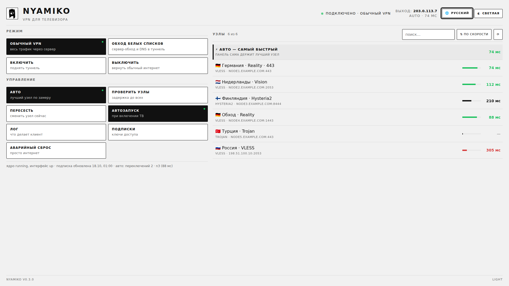
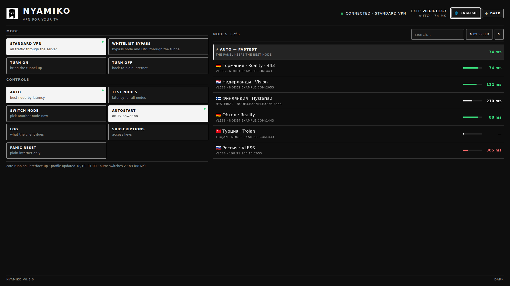
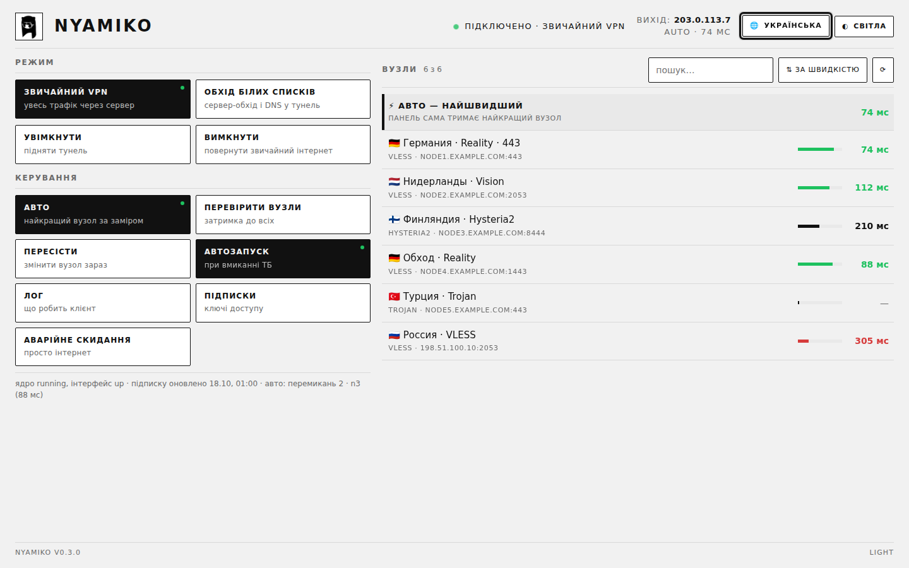
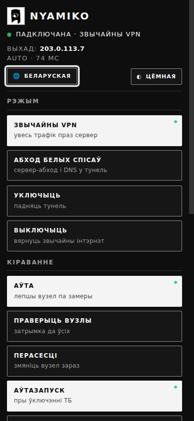

# Nyamiko

**VPN-клиент, который живёт на самом телевизоре LG.** sing-box с TUN-интерфейсом,
чёрно-белая панель под пульт, замер задержки до каждого узла, автовыбор самого
быстрого и автопереключение на ходу — без ноутбука, роутера и «всегда включённой
коробочки» рядом с телевизором.

Работает с обычными подписками в формате Clash/Mihomo (VLESS+Reality, Trojan,
Hysteria2 и т.д.), в том числе с панелями, которые привязывают подписку к
устройству (`x-hwid`, Remnawave).

[In English →](README.md) · [Установка](INSTALL.md) · [Как пользоваться](docs/USAGE.md) ·
[Вопросы](docs/FAQ.md) · [Если не работает](docs/TROUBLESHOOTING.md) ·
[API](docs/API.md) · [Как устроено](docs/ARCHITECTURE.md) · [Что дальше](docs/ROADMAP.md)

| Светлая | Тёмная |
|---|---|
|  |  |

Та же панель открывается на телефоне и на ноутбуке — тема и язык берутся
у устройства:

| Українська (ноутбук) | Беларуская (телефон) |
|---|---|
|  |  |

## Что умеет

- **Весь трафик телевизора через туннель.** Маршрутизация на ядре, где нет
  policy routing (`ip rule` в webOS 4 не работает), защита от петли и аварийный
  откат на обычный интернет одной кнопкой.
- **Два режима:** «Обычный VPN» (всё через сервер, VK Видео — мимо туннеля) и
  «Обход белых списков» (для операторов, которые пропускают только список
  адресов — работает по второй подписке).
- **Панель под пульт.** Стрелки, OK, «назад» — мышка не нужна. Чёрно-белый
  дизайн, который берёт тему у телевизора, **четыре языка интерфейса** (Русский,
  English, Українська, Беларуская) — язык тоже подтягивается от системы; поиск и
  сортировка узлов, выходной IP, лог, аварийный сброс.
- **Замер задержки** до каждого узла (по несколько за раз, чтобы не подвесить
  телевизор) и **автовыбор** лучшего.
- **Автопереключение без панели:** клиент каждую минуту щупает канал через
  активный узел, после трёх провалов пересаживается на живой, не дёргается
  (пауза 10 минут, успокаивается после двух удачных проб) и сам проверяет, не
  появился ли узел быстрее.
- **Живое переключение узлов** через Clash-API ядра — без перезапуска туннеля.
- **Автообновление подписки** раз в сутки (обязательно при опущенном туннеле).
- **Починка хранилища сертификатов:** в прошивках 2018 года нет 76 корневых
  сертификатов — из-за этого не открываются VK и VK Видео.
- **Сторожевые механизмы:** автозапуск при включении телевизора, перезапуск
  ядра, восстановление маршрутов, обрезка логов, чистка `/tmp`.

## Что нужно

1. **Рутованный LG TV** (webOS 3.5–4.x; проверено на телевизоре LG 2018 года,
   webOS 4.4). Рутирование — [webosbrew](https://www.webosbrew.org/),
   Homebrew Channel.
2. **Подписка** в формате Clash/Mihomo. Ключ остаётся только на телевизоре.
3. **SSH** на телевизор (`ssh root@<ip>`) и `node` (ставится с Homebrew
   Channel).

## Установка

На телевизоре:

```sh
curl -fsSL https://raw.githubusercontent.com/yanineko77/nyamiko/main/install.sh \
  | sh -s -- "https://ваша-панель/sub/КЛЮЧ"
```

Вторым аргументом можно дать ссылку для режима «обход белых списков».
`--update` обновляет файлы, сохраняя ключи и настройки; `--uninstall` удаляет
всё. Подробности, ручная установка и проверка после установки —
[INSTALL.md](INSTALL.md).

Отдельно собирается приложение-обёртка `.ipk` для Homebrew Channel ([packaging/ipk](packaging/ipk/README.md)): клиент ставится и обновляется с пульта, без ssh. Оно вызывает root-сервис Homebrew Channel, поэтому нужен рутованный телевизор с установленным каналом.

## Как пользоваться

Откройте `http://<ip телевизора>:8099/` с телевизора, телефона или ноутбука и:

1. нажмите **«Авто»** один раз — клиент замерит все узлы и будет держать самый
   быстрый;
2. выберите **режим** — туннель перестроится сам;
3. забудьте про панель — дальше клиент переключается сам.

Остальное (подписки, лог, аварийный сброс, язык, тема) — там же:
[docs/USAGE.md](docs/USAGE.md).

## Как устроено

```
телевизор
├── sing-box (ядро)   TUN sbtun, маршрут по умолчанию -> туннель,
│                     Clash-API 127.0.0.1:9090 (переключение, замеры)
├── tunnelctl.sh      up/down/fetch/status/watch/rescue, маршруты, DNS
├── tvtunnd.js        панель :8099 + JSON-API, сторож автопереключений
└── ui.html           интерфейс (пульт, 4 языка, тема от устройства)
```

Подробно: [docs/ARCHITECTURE.md](docs/ARCHITECTURE.md).
Сертификаты: [docs/TRUST-STORE.md](docs/TRUST-STORE.md).

## Безопасность и приватность

- Ключи подписки живут только на телевизоре
  (`/media/internal/tv-tunnel/config.json`, права 600) и уходят только на вашу
  панель.
- Панель открыта домашней сети по умолчанию — чтобы можно было управлять с
  телефона. Поставьте `"require_key": true` в `config.json`, и для внешних
  обращений потребуется `?k=<ключ>`.
- В системный раздел ничего не пишется: клиент живёт в `/media/internal` и
  удаляется вместе с папкой.

## Лицензия и оговорка

MIT — см. [LICENSE](LICENSE). Nyamiko — клиент для **вашей собственной**
подписки. Использование VPN частным лицом само по себе не наказывается, но
**реклама и популяризация способов обхода блокировок запрещены** и наказываются
административно. Ответственность за использование и распространение — на вас.
Не выкладывайте ключи подписок и не превращайте проект в публичный сервис.
